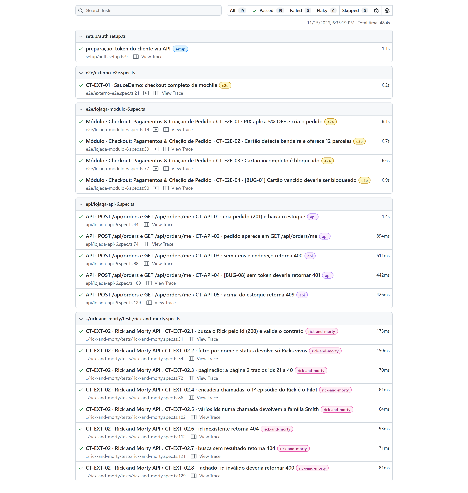
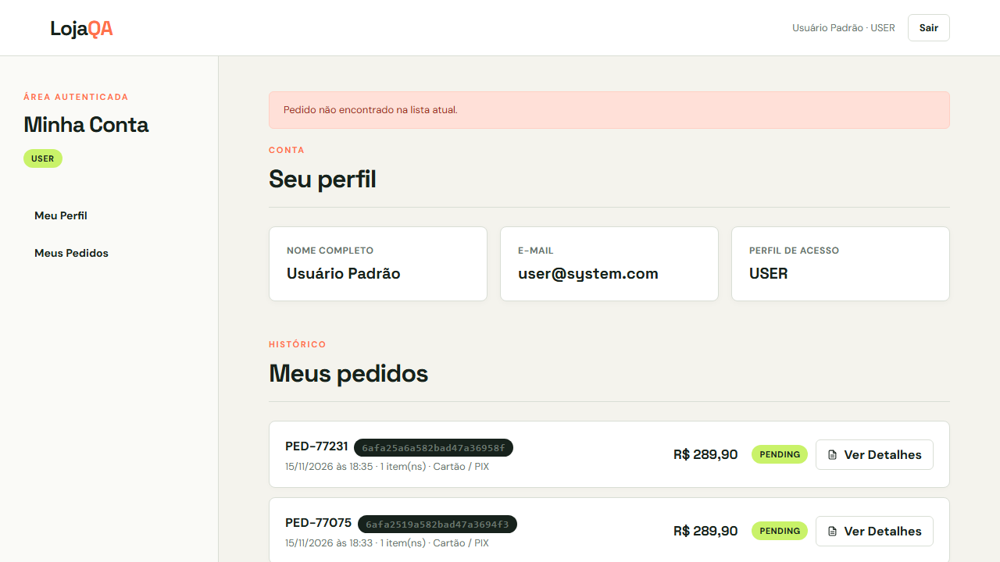
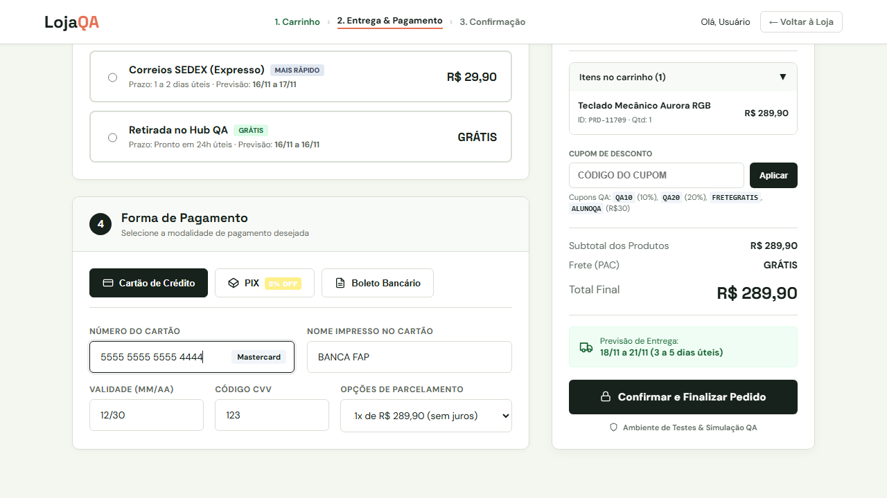
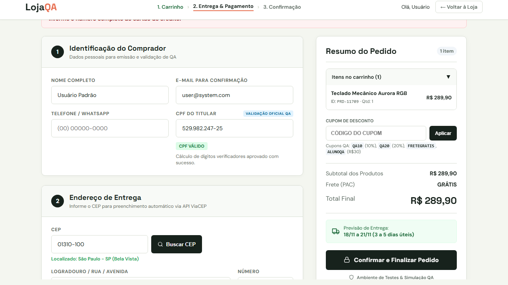
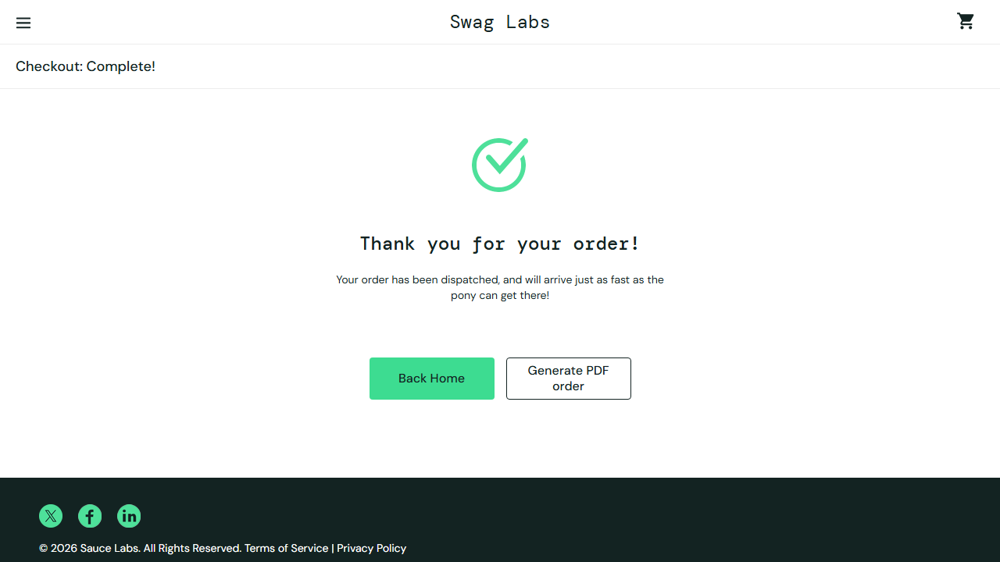
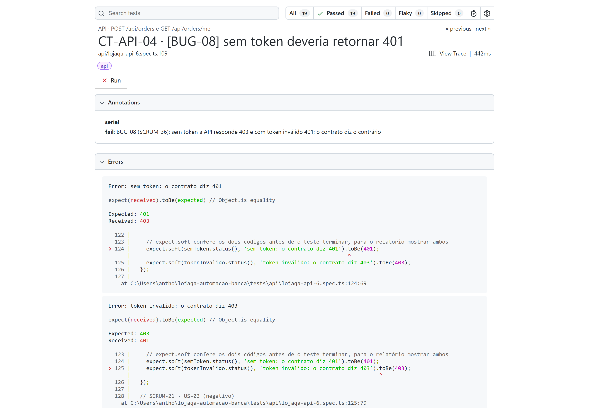
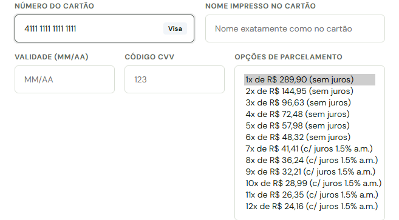

# Loja QA · Automação de Testes · Banca 06: Checkout & Pagamentos

Suíte **Playwright + TypeScript** que testa o checkout da [Loja QA](https://alisonmelo.github.io/tioalison-pe-t4-fap26/projetos-base/01-sistema-login/) pela **tela (E2E)** e pela **API**, mais dois testes em sistemas reais do mercado (SauceDemo e Rick and Morty API).

**FAP 2026 · Testes de Software · Turma 4 · Prof. Alison Melo**
Equipe: **Anthony Ricardo** (base + E2E, Scrum Master) · **André** (API + dados + README) · **Rodrigo** (externos, Jira/Zephyr, slides)

---

## Resultado

**19 testes, 19 dentro do esperado** (última execução completa: 15/11/2026, 48 s, a partir do zero com login novo).
16 passam e 3 falham **como esperado** (`test.fail`), cada um documentando um defeito real encontrado.

| Suíte | Arquivo | Testes | Resultado |
| --- | --- | --- | --- |
| E2E Loja QA | `tests/e2e/lojaqa-modulo-6.spec.ts` | 4 | 3 passam · 1 documenta o BUG-01 |
| API Loja QA | `tests/api/lojaqa-api-6.spec.ts` | 5 | 4 passam · 1 documenta o BUG-08 |
| Externo E2E (SauceDemo) | `tests/e2e/externo-e2e.spec.ts` | 1 | passa |
| Externo API (Rick and Morty) | `rick-and-morty/tests/rick-and-morty.spec.ts` | 8 | 7 passam · 1 documenta um achado na API pública |
| Preparação (login via API) | `tests/setup/auth.setup.ts` | 1 | passa |



---

## Arquitetura

```
lojaqa-automacao-banca/
├── playwright.config.ts          Painel de controle: 4 projects (setup, e2e, api, rick-and-morty)
├── package.json                  Dependências e atalhos (npm run ...)
├── tsconfig.json                 TypeScript em modo strict
├── .env.example                  Modelo das variáveis (copie para .env)
├── fixtures/
│   ├── sessao.ts                 Caminho único do arquivo do token
│   └── auth.fixture.ts           Abre a loja já logada e entrega o Page Object
├── pages/
│   └── CheckoutPage.ts           Page Object do checkout: COMO mexer na tela (sem expect)
├── data/
│   └── checkout.data.ts          Massa de dados: produto, CPF, CEP, cartões, mensagens da API
├── tests/
│   ├── setup/auth.setup.ts       Login 1 vez via API; reaproveita o token por 1 hora
│   ├── e2e/lojaqa-modulo-6.spec.ts   CT-E2E-01 a 04 (tela da Loja QA)
│   ├── e2e/externo-e2e.spec.ts       CT-EXT-01 (SauceDemo)
│   └── api/lojaqa-api-6.spec.ts      CT-API-01 a 05 (POST /orders e GET /orders/me)
├── rick-and-morty/               Desafio de mercado de API, em pasta própria (ver o README dela)
│   ├── api/RickAndMortyApi.ts    API Object
│   ├── fixtures/                 Entrega o API Object ao teste
│   ├── data/                     Massa de dados
│   └── tests/                    CT-EXT-02.1 a 02.8
├── docs/evidencias/              Prints e saídas de console das execuções
└── presentation/                 Slides da banca em PDF
```

**A frase da arquitetura:** o *spec* diz **o que** testar, o *Page Object* diz **como** mexer na tela, a *fixture* prepara o terreno e o *config* amarra tudo. Cada camada tem uma responsabilidade só.

---

## Instalação

Pré-requisitos: Node.js 18 ou mais e Git.

```bash
git clone https://github.com/anthony-ricardox/lojaqa-automacao-banca.git
cd lojaqa-automacao-banca
npm ci                                  # instala as dependências exatas do package-lock
npx playwright install chromium         # baixa o navegador
cp .env.example .env                    # PowerShell: Copy-Item .env.example .env
```

Depois de copiar, abra o `.env` e troque `coloque-a-senha-aqui` pela senha do cliente que aparece na tela de login da Loja QA. O `.env` não vai para o GitHub.

---

## Como rodar

| Comando | O que faz |
| --- | --- |
| `npm test` | Roda **tudo** (19 testes) |
| `npm run test:e2e` | E2E da Loja QA com o navegador aberto |
| `npm run test:e2e:ui` | E2E no **UI Mode** (linha do tempo, DOM de cada passo, rede) |
| `npm run test:e2e:debug` | E2E no **Inspector**: pausa antes de cada ação, passo a passo |
| `npm run test:api` | API da Loja: imprime status, headers e JSON no terminal |
| `npm run test:api:ui` | API no UI Mode: cada requisição e resposta na aba de rede |
| `npm run test:sauce` | CT-EXT-01 (SauceDemo) com o navegador aberto |
| `npm run test:rm` | Rick and Morty API (8 casos) |
| `npm run test:rm:ui` | Rick and Morty no UI Mode |
| `npm run test:ext` | Os dois desafios de mercado juntos |
| `npm run test:ui` | UI Mode com **todos** os testes |
| `npm run report` | Abre o relatório HTML da última execução |
| `npm run typecheck` | Confere os tipos do TypeScript sem rodar nada |

### Normal, UI ou debug: qual usar

| Modo | Como é | Use para |
| --- | --- | --- |
| **Normal** (`--headed`) | O robô roda direto, com a tela aberta | **A demonstração ao vivo.** Com `SLOWMO=400` no `.env`, a plateia acompanha cada campo |
| **UI Mode** (`--ui`) | Janela com a lista de testes, linha do tempo e o "antes e depois" de cada ação | **Explicar** o que aconteceu: volte a qualquer passo, veja o DOM e as requisições. É o melhor para os testes de **API** |
| **Debug** (`--debug`) | Abre o Playwright Inspector e **pausa antes de cada ação** | **Investigar** um erro, passo a passo. Evite na apresentação: depende de clicar em cada passo |

**Recomendação para a banca:** rodar ao vivo com `npm run test:e2e` (`SLOWMO=400`), e usar `npm run test:api:ui` e `npm run test:rm:ui` para explicar as APIs. Tenha o `npm run report` aberto como plano B.

### Variáveis do `.env`

| Variável | Para quê |
| --- | --- |
| `LOJA_URL` | Endereço da loja (termina com `/`) |
| `API_URL` | Endereço da API da loja (termina com `/api/`) |
| `CLIENTE_EMAIL` / `CLIENTE_SENHA` | Conta pública de cliente da tela de login da Loja QA |
| `RICK_MORTY_URL` | API pública do desafio (opcional) |
| `SLOWMO` | Atraso entre as ações do robô, em ms (400 na banca) |
| `EVIDENCIA` | `1` grava vídeo, print e trace de todos os testes |

---

## Matriz de testes

| ID | Cenário | Tipo | Resultado esperado | Dono |
| --- | --- | --- | --- | --- |
| CT-E2E-01 | Pagar com PIX e finalizar | E2E | "Desconto PIX (5% OFF)", total = subtotal × 0,95, pedido 201 na API e listado no painel | Anthony |
| CT-E2E-02 | Bandeira e parcelamento | E2E | 4111… → Visa, 5555… → Mastercard, 12 parcelas | Anthony |
| CT-E2E-03 | Cartão com 12 dígitos | E2E negativo | Aviso de número incompleto e continua no checkout | Anthony |
| CT-E2E-04 | Cartão vencido (01/20) | E2E · BUG-01 | Deveria bloquear; hoje envia o pedido (`test.fail`) | Anthony |
| CT-API-01 | Criar pedido válido | API | 201, `pending`, estoque −1 | André |
| CT-API-02 | Pedido em `/orders/me` | API | 200 e a lista contém o pedido criado | André |
| CT-API-03 | Sem itens/endereço e quantidade 0 | API negativo | 400 com as mensagens da API | André |
| CT-API-04 | Sem token e token inválido | API · BUG-08 | Contrato: 401 e 403; hoje 403 e 401 (`test.fail`) | André |
| CT-API-05 | Quantidade acima do estoque | API negativo | 409 "Estoque insuficiente para …" | André |
| CT-EXT-01 | SauceDemo: checkout da mochila | Externo E2E | "Thank you for your order!" e total = itens + imposto | Rodrigo |
| CT-EXT-02 | Rick and Morty API (8 casos) | Externo API | 200, filtros, paginação, encadeamento, 404; achado 500 | Anthony |

---

## Defeitos encontrados

| Bug | O que acontece | Severidade | Como foi confirmado | Jira |
| --- | --- | --- | --- | --- |
| BUG-01 | Validade do cartão não é conferida: 01/20 é aceito | Alta | CT-E2E-04 | SCRUM-28 |
| BUG-02 | Parcelas de 7x a 12x dizem "c/ juros 1,5% a.m.", mas o valor é total ÷ n | Média | Print: 7x de R$ 41,41 = 289,90 ÷ 7 | SCRUM-29 |
| BUG-03 | Arredondamento do PIX: 289,90 − 14,50 = 275,40, a tela mostra 275,41 | Baixa | Print do resumo | SCRUM-30 |
| BUG-04 | Número de cartão inválido no algoritmo de Luhn é aceito e enviado | Média | Print + pedido interceptado | SCRUM-31 |
| BUG-05 | Painel: status sempre vermelho e frete sem 2 casas ("R$ 16.9") | Baixa | Código do `painel.js` (linhas 196 e 260) | SCRUM-32 |
| BUG-06 | Depois do pedido, o painel abre com `orderId=undefined` e sem o modal | Alta | CT-E2E-01 | SCRUM-34 |
| BUG-07 | Pedido PIX é salvo com o valor cheio: o desconto só existe na tela | Alta | CT-E2E-01 + `GET /orders/me` | SCRUM-35 |
| BUG-08 | API troca 401 e 403 em relação ao contrato | Média | CT-API-04 | SCRUM-36 |

Na API pública do desafio também apareceu um achado: `GET /character/abc` devolve **500** em vez de 400 (CT-EXT-02.8).

---

## Evidências

| | |
| --- | --- |
|  |  |
| CT-E2E-01 · pedido PIX criado; o painel mostra o BUG-06 e o BUG-07 | CT-E2E-02 · bandeira detectada e parcelas |
|  |  |
| CT-E2E-03 · cartão incompleto bloqueado | CT-EXT-01 · SauceDemo concluído |
|  |  |
| CT-API-04 · Expected 401, Received 403 (BUG-08) | BUG-02 · "com juros" sem juros |

As saídas de console dos testes de API estão em `docs/evidencias/*-console.txt`. Vídeos de cada teste estão anexados nos cards do Jira.

---

## Regras que o código segue

- **Page Object sem `expect`:** o Page Object age, o spec verifica.
- **Zero `waitForTimeout`:** a espera é por eventos reais (`waitForResponse`, `waitForURL`, `expect` com repetição).
- **Seletores semânticos:** `getByRole` nos botões, `getByTestId` nos campos (lendo o `id`, configurado no `playwright.config.ts`).
- **Login só como preparação:** 1 vez pela API, reaproveitado por 1 hora (a API aceita 5 logins a cada 15 minutos).
- **Bug conhecido vira teste:** `test.fail` documenta o defeito e avisa quando ele for corrigido.
- **IDs iguais em todo lugar:** CT-xx no código, no Jira e nos slides.

---

## Problemas comuns

| Sintoma | Causa provável | Solução |
| --- | --- | --- |
| Setup falha com 429 | Mais de 5 logins em 15 minutos | Espere 15 minutos; não apague `.auth/` à toa |
| Primeira chamada dá timeout | Servidor do Render "dormindo" | Abra `https://api-qa-fap2026.onrender.com/api/health` e rode de novo |
| A loja manda para a tela de login | Token expirado | Apague `.auth/sessao.json` e rode de novo |
| Teste de API dá 404 | Caminho com barra no começo (`'/orders'`) | Use `'orders'`: a `baseURL` já termina em `/api/` |
| `process.env.X` é `undefined` | Falta o `.env` | Copie o `.env.example` para `.env` |

---

## Dia da banca

1. 07h30: abrir `https://api-qa-fap2026.onrender.com/api/health` para acordar a API.
2. 07h45: `npm test` uma vez (gera o token e confere a rede).
3. 08h15: terminais abertos na pasta, zoom de 150%, `SLOWMO=400` no `.env`, relatório aberto como plano B.

Licença MIT.
